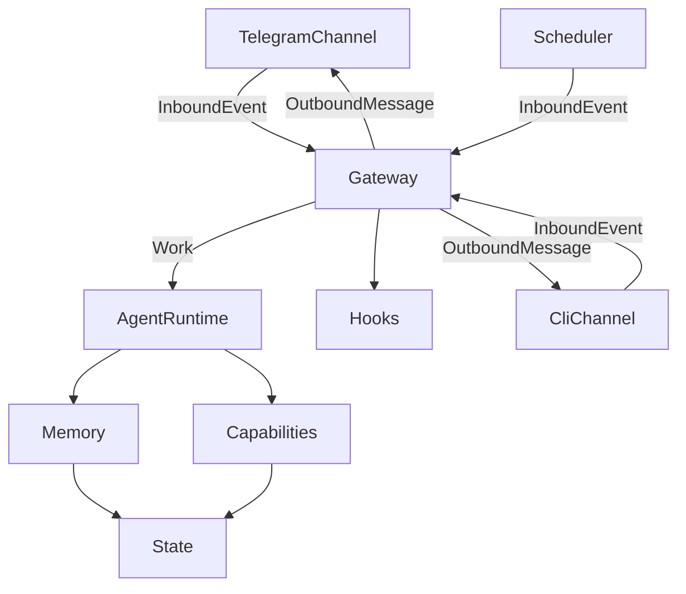

# self-agent

A personal agent on the OpenAI Agents SDK. Messages enter through the channels named in `CHANNELS`. The gateway turns each one into a single piece of work, and the runtime calls the model. Memory stays on disk.

[](https://python.org)
[](https://openai.github.io/openai-agents-python/)
[](https://python-telegram-bot.org/)

基于 **OpenAI Agents SDK** 的个人 AI Agent。在 `.env` 里用 `CHANNELS` 选 Telegram、本机终端，或两个一起开。它可以在工作区里读写文件、执行命令、抓取网页、创建定时任务，并把长期记忆留在模型外面。

分层、一条消息怎么走完、以及怎么加通道、模型和钩子，写在 [架构与流程](docs/架构与流程.md)。

---

## 这是什么

通道把一句话收成事件，网关做成一轮工作，执行层调用模型和工具，回复再沿原通道送回来。定时任务走同一条路，只是入口换成调度器。

```
你: 1 分钟后提醒我喝水
助手: 任务 a1b2c3d4 已创建。下次执行：2026-10-20T09:21:00+00:00

（一分钟后）
助手: 喝水时间到了。
```

## 快速开始

需要 Python 3.10+、[uv](https://docs.astral.sh/uv/)，以及 OpenAI API Key 或兼容的 Responses API。要用 Telegram，再向 [@BotFather](https://t.me/BotFather) 要一个 Bot Token。

```bash
uv sync
cp .env.example .env
# 编辑 .env：CHANNELS、OPENAI_API_KEY；用 Telegram 时再填 TELEGRAM_BOT_TOKEN 和 OWNER_ID

uv run python -m src
```

`CHANNELS=cli` 时在本机终端对话，不必填 Telegram。`/clear` 清空当前会话，`exit` 或 Ctrl-D 退出。终端里创建的定时任务只在这个进程还开着时投递。

## 架构



| 层 | 职责 |
|----|------|
| 通道 | 接入外界，并把回复发出去。启用哪些看 `CHANNELS` |
| 网关 | 把事件收成一条 `Work`，再把回复投回原通道 |
| 执行 | 取记忆、装配工具、跑模型、归档 |
| 模型 | 按 `MODEL_PROVIDER` 接上客户端 |
| 能力 | 这一轮的工具和 Skill |
| 记忆 | 状态留在模型外面，提示里只放一小段 |
| 持久化 | 任务库和会话库 |
| 钩子 | 工作开始前、回复投递后。默认不登记，用法见架构文档 |

```
src/
├── __main__.py          读 CHANNELS，准备目录，启动已启用的通道
├── config.py            环境变量和路径
├── work.py              InboundEvent、OutboundMessage、Work
├── gateway.py           网关
├── runtime.py           一轮工作的顺序
├── stream_log.py        流式事件怎么写入过程日志
├── hooks.py             register_before / register_after
├── models/              供应商登记表
├── channels/            通道登记表
├── capabilities/        工具、Skill 和 MCP
├── memory/              MEMORY.md 和每日归档
└── state/               定时任务和会话
```

## 配置

| 变量 | 必填 | 默认值 | 说明 |
|------|------|--------|------|
| `CHANNELS` | 是 | — | 逗号分隔。已登记 `cli`、`telegram` |
| `TELEGRAM_BOT_TOKEN` | 启用 telegram 时 | — | Bot Token |
| `OWNER_ID` | 启用 telegram 时 | — | 你的 Telegram 用户 ID |
| `MODEL_PROVIDER` | 否 | `openai` | `openai` 或 `vllm` |
| `OPENAI_API_KEY` | `openai` 时 | — | OpenAI API Key |
| `OPENAI_BASE_URL` | 否 | 官方 | 兼容端点，走 Responses API |
| `OPENAI_MODEL` | 否 | `gpt-4.1` | `openai` 的模型名 |
| `VLLM_BASE_URL` | `vllm` 时 | — | 端点，例如 `http://127.0.0.1:8000/v1` |
| `VLLM_API_KEY` | 否 | `empty` | `vllm` 的密钥 |
| `VLLM_MODEL` | 否 | `Qwen3.6` | `vllm` 的模型名 |
| `THINKING_TOKEN_BUDGET` | 否 | `1024` | `vllm` 的思考 token 上限。思考仍开启 |
| `ASSISTANT_NAME` | 否 | `Ape` | 助手名称 |
| `TIMEZONE` | 否 | `UTC` | 调度时区，中国可用 `Asia/Shanghai` |
| `SCHEDULER_INTERVAL` | 否 | `60` | 扫描到期任务的间隔，单位秒 |
| `QIANFAN_API_KEY` | 否 | — | 千帆网页搜索。不填则跳过这项 MCP |

获取用户 ID：在 Telegram 搜索 `@userinfobot`，发任意消息。

## 数据目录

| 路径 | 用途 |
|------|------|
| `workspace/` | 文件工具和命令的工作目录 |
| `workspace/MEMORY.md` | 长期记忆。不存在时按模板创建。`/clear` 不会删它 |
| `workspace/conversations/` | 按日归档，`YYYY-MM-DD.md` |
| `store/self-agent.db` | 定时任务 |
| `data/sessions.db` | 当前会话。重启后还在 |
| `.env` | 本地凭据，不要提交 |

## 安全提醒

这个 Agent 能在 `workspace/` 里执行命令。文件工具也不能写出工作区。它只适合你自己用。不要把 Token、API Key 交出去，也不要部署成任何人都能访问的服务。启用 Telegram 时，只有 `OWNER_ID` 的消息会得到回复。
