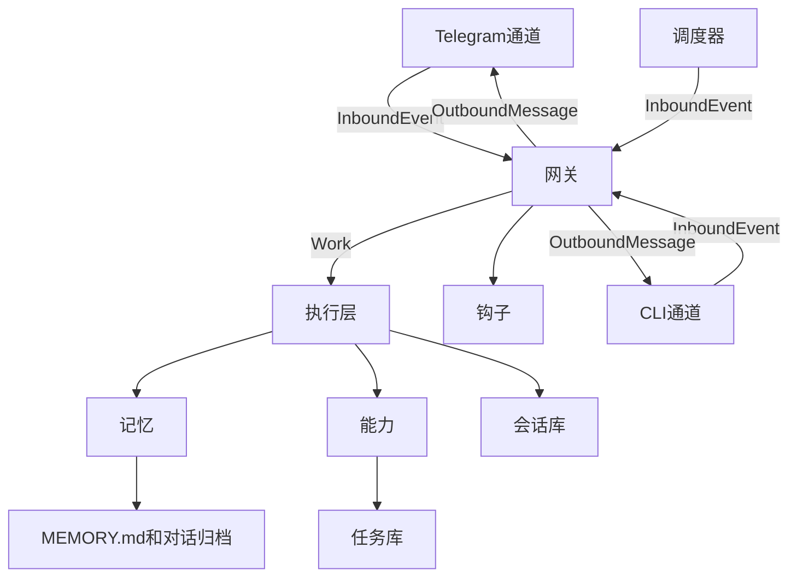
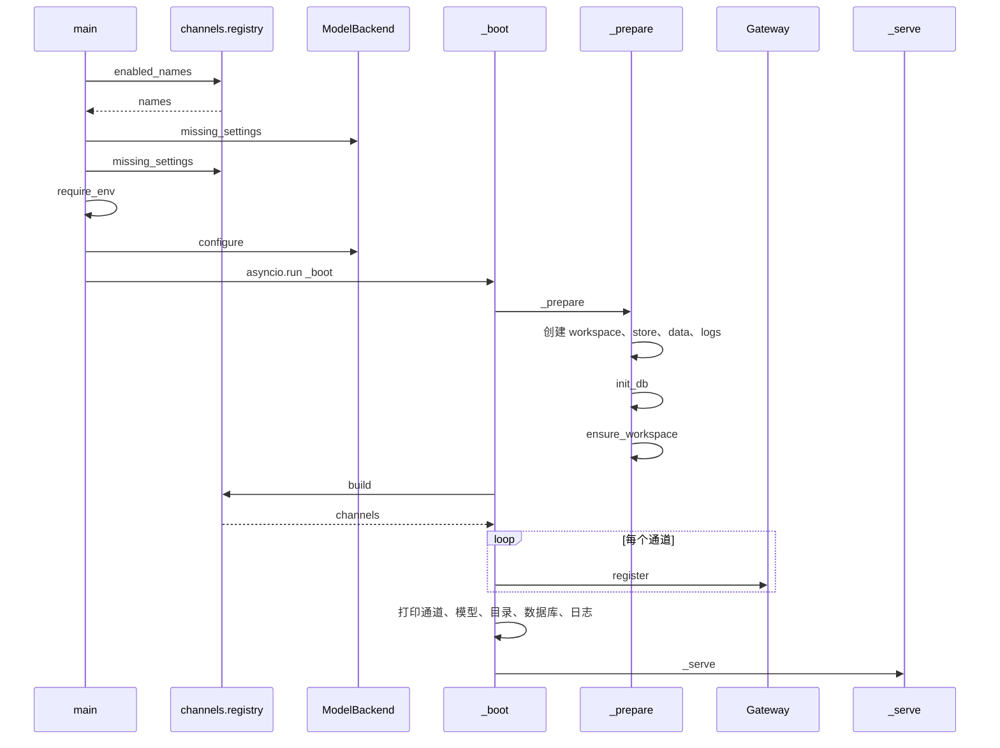
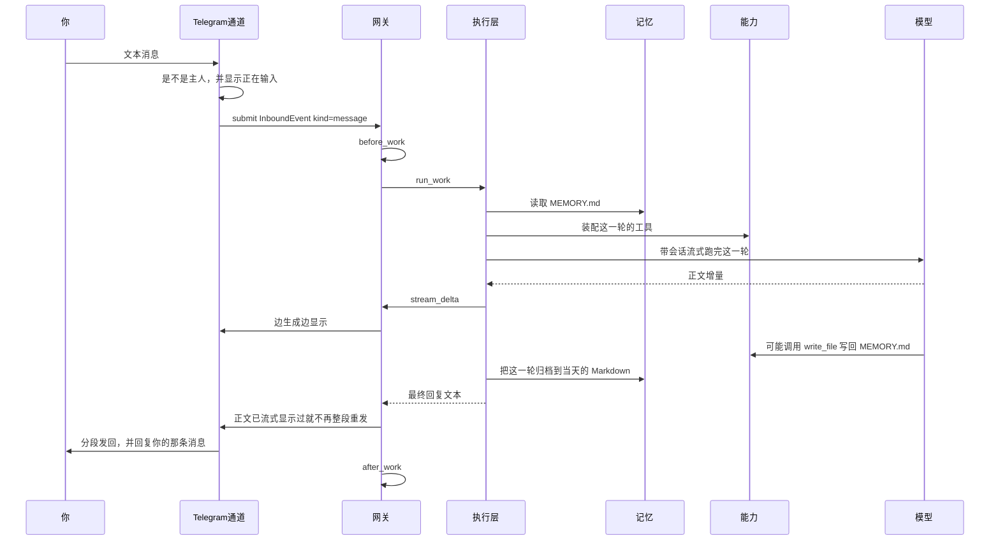
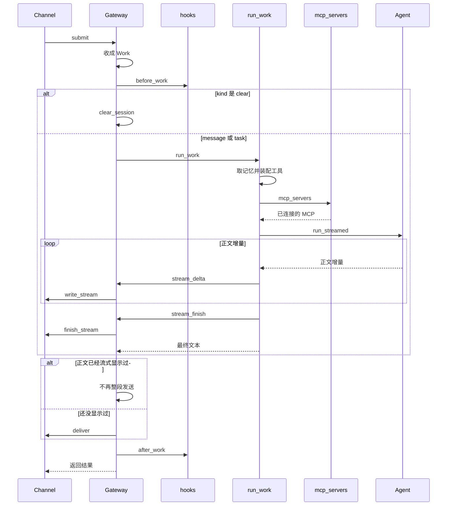

# 架构与流程

这份说明讲这个项目怎么分层、一条消息怎么走完、定时任务和记忆放在哪里。读的时候可以对照 `src/` 里的文件。

## 一句话

外界只跟通道说话。通道把一件事交给网关，网关把它收成一条工作，执行层跑完这一轮，网关再把回复投回原来的通道。

模型不保存你的偏好，也不保存聊天记录。这些都在磁盘上。每轮只从记忆里取出一小段放进提示。

## 分层



| 层 | 文件 | 它负责什么 | 它不负责什么 |
|----|------|------------|--------------|
| 通道 | `src/channels/` | 接入 Telegram 或本地终端、把文本变成事件、把回复发出去 | 不调用模型，不读写任务库 |
| 网关 | `src/gateway.py` | 把事件收成一条 `Work`，跑完后把回复投回原通道 | 不认识 Telegram 的消息对象，不调用模型 |
| 执行 | `src/runtime.py` | 握住一轮工作：取记忆、装配工具、跑模型、归档日常对话 | 不 import 任何通道，也不认识具体供应商 |
| 模型 | `src/models/` | 按 `MODEL_PROVIDER` 接上客户端，并给出模型名 | 不跑对话，不认识通道 |
| 能力 | `src/capabilities/` | 提供这一轮可用的工具 | 发消息时走网关，不直接拿 Bot |
| 记忆 | `src/memory/` | 长期记忆和每日归档都留在模型外面 | 不把整天的对话塞进提示 |
| 持久化 | `src/state/` | 任务库存定时任务，会话库存对话连续性 | 通道和网关不直接写任务库 |
| 钩子 | `src/hooks.py` | 工作开始前、回复发出后可以插入逻辑 | 现在默认是空的 |

调度器不是通道。它只是另一个入口：到点后提交一条事件，回复仍交给任务记录里的那个通道。

三条会在层与层之间传递的数据定义在 `src/work.py`：

- `InboundEvent`：谁交上来的。包含通道名、聊天 ID、文本、种类（`message`、`task`、`clear`）、要不要沿用会话。
- `Work`：网关交给执行层的一轮工作。里面还有一个 `notified`，用来记这轮有没有主动发过消息。
- `OutboundMessage`：要投回去的回复。包含通道名、聊天 ID、文本，以及可选的“回复哪条消息”。

## 启动

入口是 `src/__main__.py`。`uv run python -m src`。启用哪些通道看 `.env` 的 `CHANNELS`，例如 `cli` 或 `telegram,cli`。

1. 读 `CHANNELS`。空着或有未登记的名字就退出，并打印已登记的名字。
2. 读 `MODEL_PROVIDER`，缺省是 `openai`，向这一家要还缺的环境变量。每个已启用通道再申报自己的缺项：Telegram 要 `TELEGRAM_BOT_TOKEN` 和 `OWNER_ID`。`vllm` 必须填 `VLLM_BASE_URL`，例如 `http://127.0.0.1:8000/v1`，不必再填 `OPENAI_API_KEY`。
3. 调用这一家的 `configure()`。`openai` 和 `vllm` 都装上 Responses 客户端。`/v1` 后面的 `responses` 路径由 OpenAI SDK 自己拼。`vllm` 的模型名默认 `Qwen3.6`。
4. 建好 `workspace/`、`store/`、`data/`、`logs/`。
5. 初始化任务库 `store/self-agent.db`。老库如果没有 `channel` 列，会补上一列，已有任务默认回到 Telegram。
6. 如果还没有 `workspace/MEMORY.md`，按模板写一份。
7. 按 `CHANNELS` 从登记表取出通道，注册到网关。终端读标准输入；Telegram 在同一个事件循环里轮询。
8. 能力层连接已登记的 MCP。每一项连不上只打印原因，对话仍可用。放映是其中一项，本机引擎在才会连上。千帆网页搜索在配置了 `QIANFAN_API_KEY` 时连上。
9. 通道都就绪后，网关再启动调度器。调度器每 `SCHEDULER_INTERVAL` 秒看一次有没有到期任务，默认 60 秒。进程退出时停掉调度器。列表里有 `cli` 时，终端结束就关掉其余通道。

同一时间只跑一轮模型。执行层有一把锁，日常对话和定时任务都会排队用它。

### 从 main 进入 _serve

`main` 先核对环境和模型，再把进程交给事件循环。目录、数据库和通道都在 `_boot` 里准备好，然后才调用 `_serve`。



### _serve

`_serve` 把 MCP 和通道放进同一个事件循环。`channel.start` 由 `create_task` 拉起，所以它和 `_wait_ready` 同时在跑。连不上的 MCP 只留下说明，不阻止启动。某个通道在声明就绪之前就失败时，`_wait_ready` 把异常抛出来，调度器不会启动。

终端通道先打印欢迎语并标成就绪，再停在 `allow_input` 上。调度器起来之后，`_serve` 才放开输入。Telegram 通道则是轮询开始后标成就绪，之后停在 `request_stop` 上。

```mermaid
sequenceDiagram
  participant Serve as _serve
  participant MCP as connect_mcp
  participant Presenter as presenter
  participant Search as web_search
  participant Loop as 事件循环
  participant Channel as Channel.start
  participant Ready as _wait_ready
  participant Gateway as Gateway
  participant Scheduler as Scheduler

  Serve->>MCP: connect_mcp
  MCP->>MCP: load 导入 presenter 和 web_search
  MCP->>Presenter: _connect
  alt 放映进程在
    Presenter->>Presenter: 创建 presentations 目录
    Presenter-->>MCP: server
    MCP->>MCP: 记下 ppt-presenter
  else 引擎缺失或连接失败
    Presenter-->>MCP: 失败说明
  end
  MCP->>Search: _connect
  alt 已配置密钥且连上
    Search-->>MCP: server
    MCP->>MCP: 记下 baidu-search
  else 没密钥或连接失败
    Search-->>MCP: 跳过或失败说明
  end
  MCP-->>Serve: notices
  Serve->>Serve: 逐条打印说明

  loop 每个通道
    Serve->>Loop: create_task channel.start
    Loop->>Channel: start
  end

  Serve->>Ready: _wait_ready
  loop 按通道顺序
    alt 通道没有 wait_until_ready
      Ready->>Ready: 任务已结束则取出异常
    else 有 wait_until_ready
      Ready->>Channel: wait_until_ready
      alt start 先结束
        Ready->>Ready: 取消等待并抛出异常
        Note over Ready,Serve: 调度器不会启动
      else 通道先声明就绪
        Channel-->>Ready: 就绪
      end
    end
  end

  Serve->>Gateway: on_running
  Gateway->>Scheduler: setup_scheduler
  Gateway->>Scheduler: start
  Scheduler-->>Gateway: 调度器已启动

  loop 有 allow_input 的通道
    Serve->>Channel: allow_input
  end

  alt 启用了 cli
    Serve->>Loop: 等到任一通道任务结束
    Note over Serve,Channel: 终端退出会带停其余通道
    Serve->>Serve: 已结束任务若有异常则抛出
  else 没有 cli
    Serve->>Loop: 等到所有通道结束
  end
```

### 退出

终端退出、通道抛错或键盘中断，都会走进 `_serve` 的 `finally`。

```mermaid
sequenceDiagram
  participant Serve as _serve
  participant Channel as Channel
  participant Loop as 事件循环
  participant Gateway as Gateway
  participant Scheduler as Scheduler
  participant MCP as cleanup_mcp

  loop 每个通道
    Serve->>Channel: request_stop
  end
  loop 未结束的任务
    Serve->>Loop: cancel
  end
  Serve->>Loop: 等任务结束，异常不再向外抛
  Channel->>Channel: 停轮询或结束读入
  Serve->>Gateway: shutdown
  Gateway->>Scheduler: shutdown
  Serve->>MCP: cleanup_mcp
  loop 按连接的相反顺序
    MCP->>MCP: server.cleanup
  end
```

## 一条普通消息

以你在 Telegram 里发“帮我记一下我喜欢早上喝咖啡”为例。



调度器起来之后，用户消息和到期任务进的是同一个 `submit`。定时任务的 `kind` 是 `task`，不带会话。`/clear` 在网关里清会话，不进执行层。



通道里实际做的事：

- 不是 `OWNER_ID` 的消息直接丢掉。
- `/start` 不进网关。通道自己回一段欢迎语。
- 普通文本会先发“正在输入”，再 `submit`。事件里带上你那条消息的 ID，所以回复会挂在那条消息下面。
- 回复超过 4096 字时，通道自己分段发送。

网关收到 `kind=message` 之后：

1. 先跑 `before_work`。没有登记钩子时，这一步什么都不做。
2. 交给 `run_work`。
3. 正文如果已经流式显示过，就不再整段重发；否则把执行层返回的文本投回原来的通道。
4. 再跑 `after_work`。

执行层在锁里做完这些事：

1. `prompt_context` 读出 `MEMORY.md`，拼进系统指令。归档文件不在这里整段读入。
2. `tools_for` 给出两组工具：工作区文件、命令、抓取网页；发消息和定时任务。
3. `Runner.run_streamed` 最多 25 个来回。`vllm` 的请求带 `thinking_token_budget`，默认 1024，思考仍开启。思考增量经网关推给实现了 `write_reasoning` 的通道；终端会边想边显示，Telegram 不实现这个方法。正文增量经网关推给通道；通道实现了 `write_stream` 时边生成边显示，这段正文不再整段重发。没有流式方法的通道仍在结束后一次性收到全文。日常对话带上 `data/sessions.db` 里的会话，所以重启后还能接着聊。过程日志里的思考正文超过 400 字时只保留开头。
4. 模型出错时，返回的文本是“出错了：…”，这轮不会把异常抛出通道。
5. 锁放开之后，如果这是日常对话，把你的话和助手的回复追加到 `workspace/conversations/YYYY-MM-DD.md`。

模型如果决定记住你的偏好，会自己调用 `write_file` 改 `MEMORY.md`。下一轮 `prompt_context` 会读到新内容。

这轮里模型也可以调用 `send_message` 先发一条。那条走网关的 `deliver`。最终回复若没有在流式正文里出现过，仍会再发一次。定时任务不一样，见下一节。

## 定时任务

你说“1 分钟后提醒我喝水”时，模型调用 `schedule_task`。工具算出下次运行时间（统一存成 UTC），在任务库里记下提示词、调度方式、聊天 ID，以及当时的通道名。

调度器醒来后，找出 `status=active` 且 `next_run` 已到的任务，为每条任务提交一个事件：

- `kind` 是 `task`
- `use_session` 是假的，所以不写进日常会话，也不进当天的对话归档
- 文本会包一层说明，要求模型用 `send_message` 把结果告诉你

网关和执行层走的还是上面那条路。差别只有投递：

- 模型调用了 `send_message`：`Work.notified["sent"]` 变成真，网关不再把最终文本发第二遍。
- 模型没有主动发：网关把最终文本投回任务记录里的通道。

跑完之后调度器更新任务。`cron` 和 `interval` 计算下一次并保持 `active`。`once` 记为 `completed`，不再跑。

`pause_task`、`resume_task`、`cancel_task`、`list_tasks` 只改任务库，不经过执行层。

## `/clear` 和 `/start`

`/start` 停在通道里，用来看欢迎语。

`/clear` 会提交 `kind=clear`。网关清空 `data/sessions.db` 里的当前会话，直接回复“会话已清除！长期记忆已保留。”，不调用模型。`MEMORY.md` 和 `conversations/` 都还在。

## 记忆和磁盘上的东西

| 路径 | 谁写 | 模型能不能直接看见 |
|------|------|--------------------|
| `workspace/MEMORY.md` | 启动时没有就建模板；之后由模型用文件工具改 | 每轮都会放进提示 |
| `workspace/conversations/` | 执行层在日常对话结束后追加 | 不会自动塞进提示；模型可以用 `glob_files`、`grep_files` 去搜 |
| `data/sessions.db` | Agents SDK 的会话 | 作为会话上下文，不是一篇你打开就能读的 Markdown |
| `store/self-agent.db` | 定时任务工具和调度器 | 通过 `list_tasks` 等工具查看 |
| `workspace/` 里的其他文件 | 文件工具和命令 | 用工具按需读取，路径不能逃出这个目录 |

命令也固定在 `workspace/` 里执行，超时 60 秒，输出会截断。网页工具只允许 `http` 和 `https`。

## 以后要加东西时动哪里

加一个通道：在 `src/channels/` 做一个对象，带上 `name` 和 `async deliver(message)`，并在模块里 `register`。`.env` 的 `CHANNELS` 写上这个名字。启动时登记表会把它交给网关。收到外界消息时调用 `gateway.submit(InboundEvent(...))`，`channel` 填这个名字。网关会按这个名字把回复送回 `deliver`。要边生成边显示，再实现 `write_stream` 和 `finish_stream`。要在终端里边想边显示，再实现 `write_reasoning` 和 `finish_reasoning`。通道若要一直运行，实现 `async start(gateway)`；需要等它准备好再拉起调度器时，再提供 `wait_until_ready`。本地终端的现成例子是 `src/channels/cli.py`，通道名是 `cli`，`chat_id` 固定为 `0`。它和 Telegram 共用 `data/sessions.db` 里的主人会话。在 CLI 里创建的定时任务，到期后只在这个进程还开着的时候打到终端。

加一个模型供应商：在 `src/models/` 做一个对象，带上 `name`、`missing_settings`、`model_name`、`model_settings`、`configure`。在 `src/models/__init__.py` 里 `register`。`.env` 的 `MODEL_PROVIDER` 写成这个 `name`。执行层只使用 `model_name()` 和 `model_settings()`，不出现具体厂商的名字。现成的两家是 `openai` 和 `vllm`。能走 OpenAI 兼容接口的，可以复用 `configure_compatible_client`。

加一个工具：写一个返回工具列表的函数，在 `src/capabilities/__init__.py` 的 `tools_for` 里并进去。要主动发消息就调用传进来的 `gateway.deliver`，不要在工具里 import Telegram。

加一个钩子：在进程启动后调用 `src/hooks.py` 的 `register_before` 或 `register_after`。前置钩子在执行前收到 `Work`，后置钩子在回复投递后收到 `Work` 和结果文本。钩子可以是普通函数，也可以是异步函数。默认不登记任何钩子，网关仍会调用这两个入口。

加一个技能：在 `skills/` 下任意子目录放 `SKILL.md`，frontmatter 里写 `name` 和 `description`。没有 `description` 的不会登记。每轮提示只放入名称、描述和文件位置。模型看到请求与某条描述相符时，调用 `read_skill` 读取正文。`disable-model-invocation: true` 的技能不进目录，但仍可用名称读取。

幻灯片成品放在 `workspace/presentations/`。`powerpoint` 的脚本在 `skills/powerpoint/scripts/`，由 `run_command` 调用；命令的 `PATH` 前置仓库 `.venv/bin`，所以能用到 `python-pptx`。

加一个 MCP：在 `src/capabilities/` 写一个连接函数，并向 `src/capabilities/mcp.py` 登记。入口启动时会连上已登记的项，执行层把连上的服务挂到这一轮的 Agent。连不上只打印原因。

全屏放映是已登记的一项 MCP，不是入口里的特例。目录 `skills/ppt-presenter/` 留在本机，不进版本库。`src/capabilities/presenter.py` 在连接时创建 `workspace/presentations/`，并用 `skills/ppt-presenter/ppt_mcp/.venv` 里的 Python 启动 `server.py`。连接和模型跑在同一个事件循环里，通道自己不负责连接。连不上只打印原因，对话和其他技能仍可用。语音模型在 `ppt_mcp/models/vits-melo-tts-zh_en/`，放映进程按自己的配置读取，不再指向别的安装目录。`ppt_mcp/config.yaml` 是本地文件。

千帆网页搜索是另一项 MCP，名称 `baidu-search`，地址是千帆的 Streamable HTTP 端点。密钥放在 `QIANFAN_API_KEY`。未配置或连不上只打印原因。
